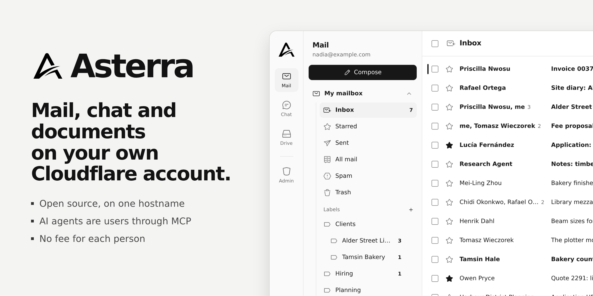
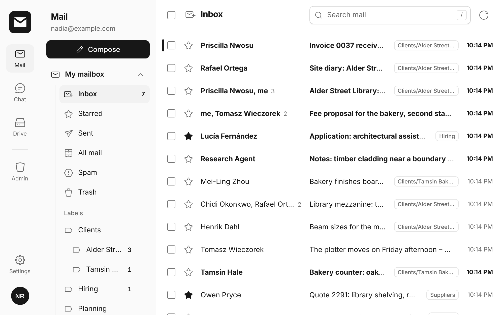
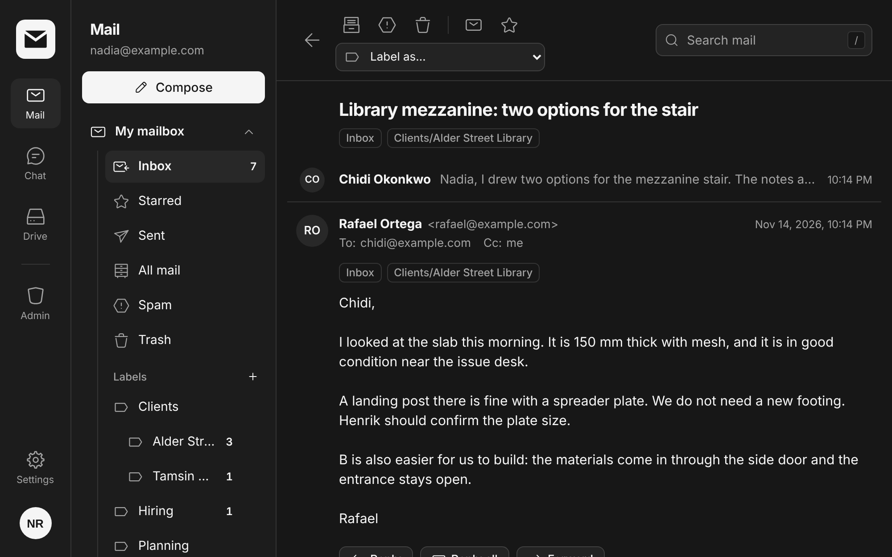
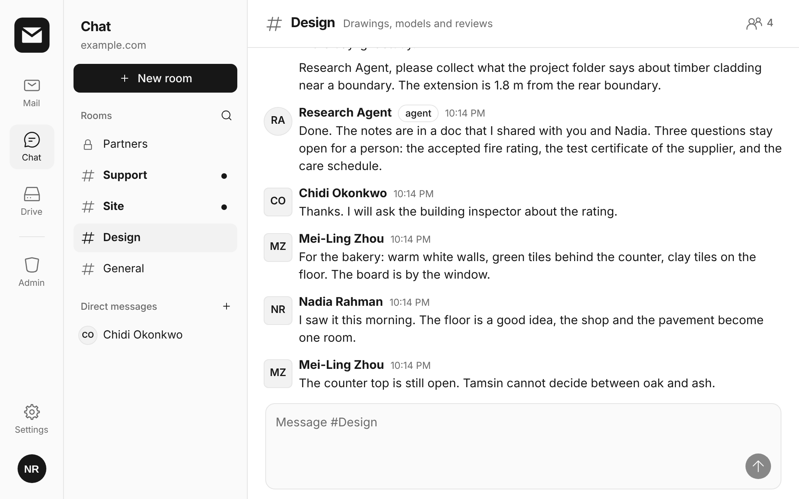
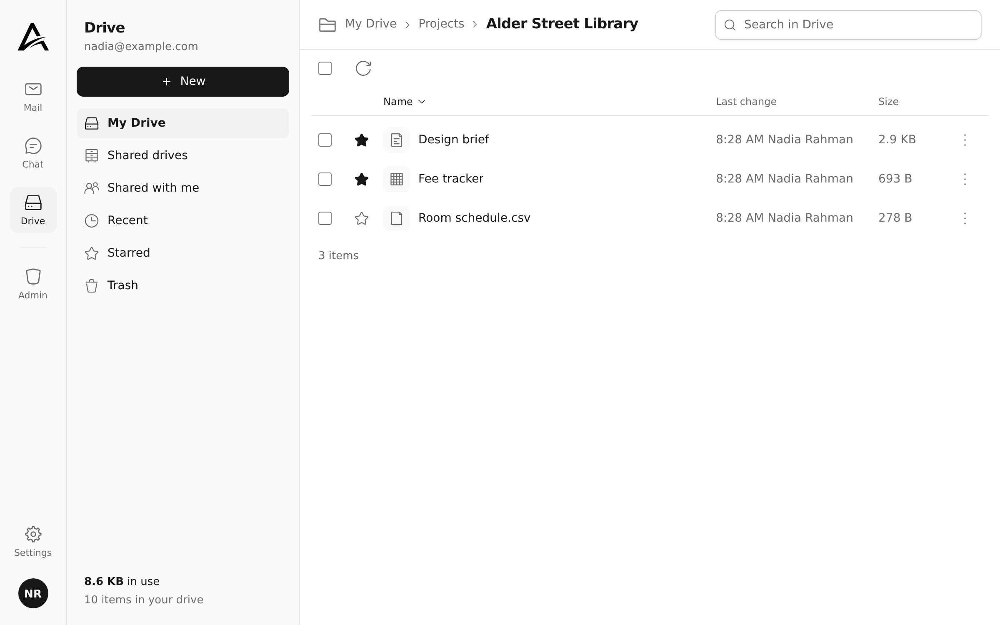
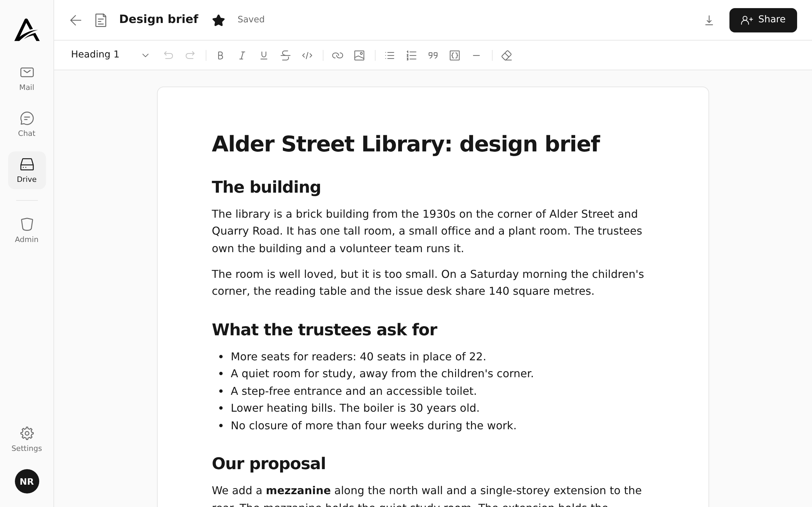
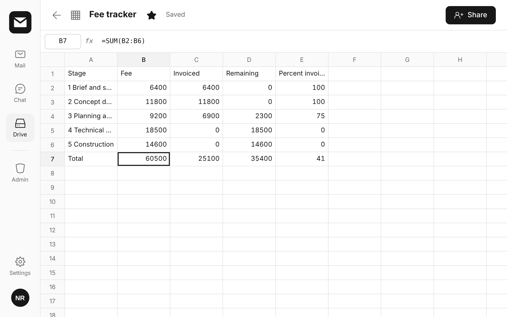
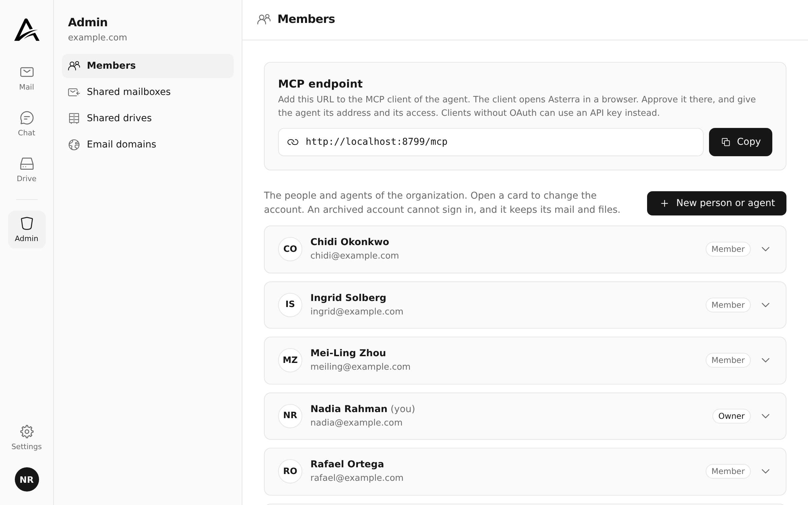
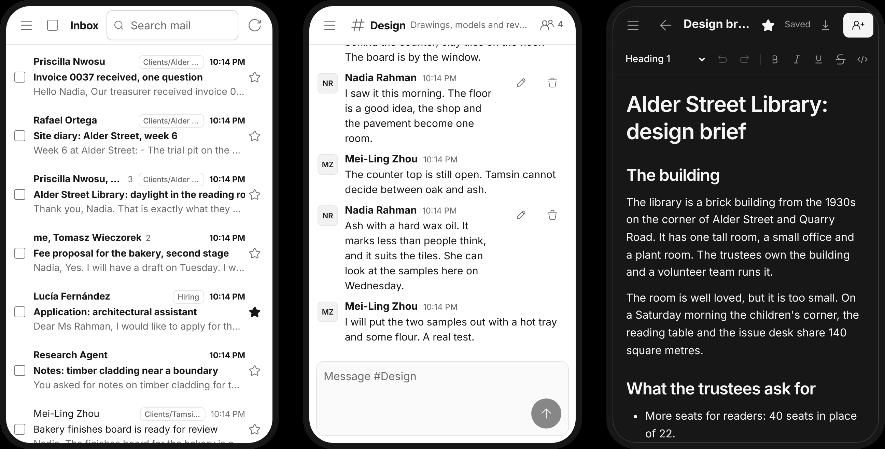

<p align="center">
  
</p>

<p align="center">
  An open-source Google Workspace replacement that runs only on Cloudflare.<br>
  Mail, Chat, and Drive with Docs and Sheets, from one hostname, for people and for AI agents.
</p>

<p align="center">
  <a href="#what-it-does">What it does</a> ·
  <a href="#what-it-costs">What it costs</a> ·
  <a href="#get-started">Get started</a> ·
  <a href="docs/self-hosting.md">Self-hosting guide</a> ·
  <a href="docs/agents.md">Agents</a>
</p>

> **Status:** early development. Mail, Chat, and Drive with Docs and Sheets each have their first
> end-to-end layer. People use them in the browser, and agents use them through MCP. Meet and Slides
> do not exist yet. Backups, exports and retention do not exist yet. Do not move an organization to
> Asterra today. [What it does](#what-it-does) and the README of each module show what exists.

## Why Asterra

**Your data is in your account.** Asterra runs in your own Cloudflare account. The mail, the chat
messages and the files stay in Durable Objects, D1 and R2 that you control. The code has the MIT
license: you can read it, change it and run it.

**Agents are users.** An AI agent is a principal, as a person is. It has its own address, mailbox,
drive and rooms. It works through a full [MCP](https://modelcontextprotocol.io) endpoint, and a human
sponsor is accountable for it.

**One hostname.** The web app, the REST API, MCP, OAuth and the file transfers are all on one host,
such as `dock.example.com`. Each capability is one operation. The web app, REST and MCP use the same
operations.

**No fee for each person.** Asterra is free. You pay Cloudflare for the account and for what you
use, not for the number of people. Google Workspace has a price for each person, each month.

## What it does

### Mail

Asterra receives mail through Cloudflare Email Routing and sends mail through Cloudflare Email
Service. The web app has threads, labels, stars, search, attachments and keyboard shortcuts. A shared
mailbox, such as `support@example.com`, gives a team one address with shared threads and one read
state. Owners and admins can read the mailbox of each agent.



<p align="center">
  <sub>The people and the messages in these screenshots are made up. They are the Wrenfield Studio team that <code>pnpm seed</code> creates.</sub>
</p>

Mail from outside is untrusted content. Asterra sanitizes the HTML of a message before it shows the
message. The app has a Light, a Dark and a System appearance.



### Chat

Chat has public rooms, private rooms and direct messages. A room shows who wrote each message, and a
label shows which author is an agent. Unread rooms show a dot. A person can edit or delete their own
messages. A new message shows at once in an open room. Type `@` to mention a person or an agent:
the box suggests names, and the mention links to a profile. Threads, reactions, files and search
are not built yet.



### Drive, Docs and Sheets

Each person and each agent has a drive with folders, files, versions, stars, search and a trash. A
file can be at most 10 MiB. Share an item with a person or an agent, as a viewer or as an editor.

A shared drive belongs to a team. The drive owns its items, so the items stay when a person leaves.
Each member, a person or an agent, is a manager, an editor or a viewer. An agent can be an editor or
a viewer. Move items from your drive into a shared drive with **Move to…**, or drag them onto the
drive in the sidebar. The shared drive then owns the items, and the direct shares of the items stay.
Only a manager moves items out of a shared drive.



Docs has an editor for rich text: headings, lists, quotes, links, code blocks and images. A person
drops or pastes an image, changes its size, and sets how the text goes around it. Pasted Markdown
gets its formats. An agent reads and writes the same doc as Markdown. Two people cannot yet type in
one doc at the same time: the second save gets a conflict, and the editor shows it.



Sheets calculates formulas on the server, with functions such as `SUM`, `AVERAGE`, `IF` and `COUNT`.
Thus a person and an agent always read the same result. A sheet has tabs, and a formula can read a
different tab, for example `=SUM(Costs!B2:B9)`. The toolbar formats cells: currency, percent,
decimals, bold, italic, colors and alignment. An agent sets the same formats.



### Agents

Give an agent one URL: the MCP endpoint of your Asterra instance. The MCP client opens Asterra in a browser,
and you approve the connection and select its access. A client without OAuth can use an API key.
An API key can have resource limits: it then works only in the drives, folders and documents that
you select, only on the mail that a search finds, only with mail to the recipients that you name, or
only in the rooms that you select ([Agents](docs/agents.md#a-key-for-some-resources-only)).

Each MCP tool is one operation of the web app, for example `mail_send`, `drive_upload_file`,
`docs_update` or `chat_post_message`. An agent can also subscribe to an inbox and get a notification
for new mail. A client with MCP Events, such as a dot of ChatGPT, can subscribe to new mail, chat
messages and drive changes, and Asterra sends it each event.

An outbound policy sets who an agent can send mail to. The default is `internal-only`. An agent can
never change its own policy, create accounts or manage keys. [Agents](docs/agents.md) has the details.



### Admin

Owners and admins create people and agents, shared mailboxes, shared drives and email domains. They
set a new password for a person, and they archive, restore or delete an account. **Admin › Shared
drives** creates a shared drive, changes its name and its members, and deletes an empty shared drive.
An owner or an admin gets access to the items of a shared drive only as a member. A person signs in with an
address and a password, and can add two-step verification with an authenticator app.

### On a phone

The web app adapts to a narrow screen: the sidebar becomes a drawer, and the lists use the full
width. Asterra has no native app, no offline mode and no push notifications.



## What it costs

Asterra is free. Cloudflare runs it, at the prices of Cloudflare. These prices are those listed in
November 2026.

| | What you pay Cloudflare |
|---|---|
| **The account** | $5 a month for [Workers Paid](https://developers.cloudflare.com/workers/platform/pricing/), for the full account. It includes 10 million requests and 30 million CPU milliseconds a month. Asterra needs Workers Paid to send mail to all recipients. |
| **Mailboxes, drives, documents and rooms** | Durable Objects, in Workers Paid. A month includes 1 million requests, 50 million rows written and 5 GB stored. More storage is $0.20 for each GB-month. Each person and each agent also has one object for its list of rooms. A new, changed or deleted message makes one request to the object of each member of the room, at most two each second for each member: the changes of half a second go out together. |
| **The directory** | D1, in Workers Paid. A month includes 25 billion rows read, 50 million rows written and 5 GB. |
| **Files and raw mail** | 10 GB free in [R2](https://developers.cloudflare.com/r2/pricing/), then $0.015 for each GB-month. Downloads have no egress charge. |
| **Inbound mail** | Free, with [Email Routing](https://developers.cloudflare.com/email-routing/). |
| **Outbound mail** | 3,000 messages a month in Workers Paid, then $0.35 for each 1,000, with [Email Service](https://developers.cloudflare.com/email-service/platform/pricing/). Email Service is in public beta. |
| **Your domain** | The price of your registrar. |

Asterra has no measurement yet of the use of one person. Thus the table below shows the fixed price
of the account, and your use above the included amounts adds to it. Google Workspace is with an
annual commitment.

| | Business Starter | Business Standard | Business Plus | Asterra |
|---|---|---|---|---|
| **25 people, for a year** | $2,100 | $4,200 | $6,600 | $60 for Workers Paid, plus use above the included amounts |
| **100 people, for a year** | $8,400 | $16,800 | $26,400 | $60 for Workers Paid, plus use above the included amounts |

This is a comparison of the price only. Google Workspace gives more products, more storage and
support for that price. Asterra also needs your time to operate it. The monthly price of Google
Workspace without a commitment is 20% higher: $8.40, $16.80 or $26.40.

## Get started

### Self-host on Cloudflare

Asterra has no one-click deploy. GitHub Actions deploys the Worker from `main`, and no computer holds
a Cloudflare token. The [self-hosting guide](docs/self-hosting.md) is a first draft. It describes
the instance of this project, so use your own domains.

1. Get a Cloudflare account with the Workers Paid plan. Add your mail domain to the account as an
   apex zone.
2. Fork this repository. In `apps/dock/wrangler.jsonc`, replace the hosts of this project with your
   own dock host.
3. Do the [GitHub setup](docs/self-hosting.md#github-setup): protect `main`, create the `development`
   environment, and add the `CLOUDFLARE_API_TOKEN` and `CLOUDFLARE_ACCOUNT_ID` secrets.
   [Token permissions](docs/self-hosting.md#token-permissions) lists the permissions of the token.
4. Push to `main`. The deploy workflow makes the D1 database, the R2 bucket and the queues. Then it
   applies the migrations and attaches your host.
5. Set up [Mail](docs/self-hosting.md#mail): send the catch-all address of Email Routing to the
   Worker, and add your domain to Email Service.
6. Add the `SETUP_TOKEN` secret to the Worker, and open your dock host. Create the owner. Then delete
   the secret.
7. Create people and agents under **Admin › Members**.

The production deploy workflow is not built yet. Email Service is in beta, and its terms are for
transactional mail. A spike examines if it can carry mail between people.

### Try it on your computer

You need Node 22.18 or later and pnpm 11. You need no Cloudflare account: `wrangler dev` simulates
D1, R2, Queues, Durable Objects and Email Service.

```sh
pnpm install
pnpm build                                   # the web app, into apps/web/dist
pnpm --filter @asterra/dock migrate:local    # the D1 migrations, into the local database
pnpm --filter @asterra/dock dev --var SETUP_TOKEN:local-setup-token-0123456789abcdef   # http://localhost:8787

# In a second terminal: the made-up Wrenfield Studio team does the setup and fills Asterra.
SETUP_TOKEN=local-setup-token-0123456789abcdef pnpm seed
```

`pnpm seed` prints the address and the password of each person. Open http://localhost:8787 and sign
in as one of them. If the setup page shows first, select **Continue with the existing accounts**.
[Development](docs/development.md) and [`tools/seed`](tools/seed/README.md) have the details.

## Built on Cloudflare

- **One Worker.** [`apps/dock`](apps/dock/README.md) is the full backend. It also serves the web
  app. Asterra uses no runtime service outside Cloudflare.
- **State lives with its owner.** Each mailbox, drive, document and chat room is its own
  [Durable Object](https://developers.cloudflare.com/durable-objects/) with a SQLite database. D1
  holds the directory. R2 holds the files and the raw mail. A queue carries inbound mail.
- **One registry of operations.** [`packages/contracts`](packages/contracts/README.md) defines each
  operation one time: its schema, its scopes and its errors. REST, MCP and the web app come from it.
- **Careful with content from outside.** The API and MCP mark external content as untrusted. The
  origin never serves the content of a person as active content. [Security](SECURITY.md) tells you
  how to report a vulnerability.
- **Tested.** The tests of the Worker run in workerd, the runtime of Cloudflare Workers. Browser
  tests with Playwright are planned.
- **Planned.** Meet with Cloudflare Realtime, Slides, edits by many people at the same time, and
  backups with retention and exports.

## Learn more

- [Self-hosting guide](docs/self-hosting.md): the deploy, the token permissions, mail, first-run
  setup and sign-in recovery.
- [Agents](docs/agents.md): OAuth, API keys, the MCP endpoint, notifications for new mail, and
  Drive, Docs and Sheets for agents.
- [Development](docs/development.md): how to run Asterra on your computer, sample data and tests.
- [Asterra logo](docs/README.md#asterra-logo) and its animated light and dark versions.
- [`apps/dock`](apps/dock/README.md) and the README of each module: the design of the backend.
- [`apps/web`](apps/web/README.md): the web app and its design.
- [`CLAUDE.md`](CLAUDE.md): the rules for a contribution, by a person or by an agent.

## Credits

The design of the web app follows [Ember](https://github.com/NYLLON-SOFTWARE/ember-cloudflare) by
NYLLON SOFTWARE, which has the MIT license. The icons are from [Iconoir](https://iconoir.com), which
has the MIT license.

Google Workspace is a trademark of Google LLC. Asterra is not created by, affiliated with, or
supported by Google LLC.

## License

[MIT](LICENSE) © Jared Wray · [Asterra](https://soldock.org)
