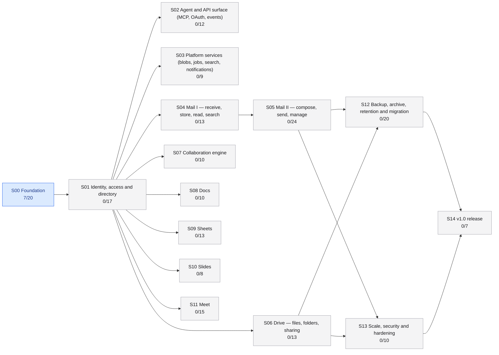

<!-- GENERATED by `pnpm plan status --write` from plan/stages/*.md. Do not edit by hand. -->

# Build status

**7 / 201 tasks done (3%)** · active stage(s): S00

The stage files in [`stages/`](stages/) are the source of truth; this page is regenerated from them.
Run `pnpm plan next` to see what to work on and [`process.md`](process.md) for how.

| Stage | Title | Status | Progress | Depends on |
| --- | --- | --- | --- | --- |
| [S00](stages/S00-foundation.md) | Foundation | active | `████░░░░░░` 7/20 | — |
| [S01](stages/S01-identity-access.md) | Identity, access and directory | planned | `░░░░░░░░░░` 0/17 | S00 |
| [S02](stages/S02-agent-api-surface.md) | Agent and API surface (MCP, OAuth, events) | planned | `░░░░░░░░░░` 0/12 | S01 |
| [S03](stages/S03-platform-services.md) | Platform services (blobs, jobs, search, notifications) | planned | `░░░░░░░░░░` 0/9 | S01 |
| [S04](stages/S04-mail-receive.md) | Mail I — receive, store, read, search | planned | `░░░░░░░░░░` 0/13 | S01 |
| [S05](stages/S05-mail-send-manage.md) | Mail II — compose, send, manage | planned | `░░░░░░░░░░` 0/24 | S04 |
| [S06](stages/S06-drive.md) | Drive — files, folders, sharing | planned | `░░░░░░░░░░` 0/13 | S01 |
| [S07](stages/S07-collaboration-engine.md) | Collaboration engine | planned | `░░░░░░░░░░` 0/10 | S01 |
| [S08](stages/S08-docs.md) | Docs | planned | `░░░░░░░░░░` 0/10 | S01 |
| [S09](stages/S09-sheets.md) | Sheets | planned | `░░░░░░░░░░` 0/13 | S01 |
| [S10](stages/S10-slides.md) | Slides | planned | `░░░░░░░░░░` 0/8 | S01 |
| [S11](stages/S11-meet.md) | Meet | planned | `░░░░░░░░░░` 0/15 | S01 |
| [S12](stages/S12-backup-archive-migration.md) | Backup, archive, retention and migration | planned | `░░░░░░░░░░` 0/20 | S05, S06 |
| [S13](stages/S13-scale-security-hardening.md) | Scale, security and hardening | planned | `░░░░░░░░░░` 0/10 | S05, S06 |
| [S14](stages/S14-release-v1.md) | v1.0 release | planned | `░░░░░░░░░░` 0/7 | S12, S13 |

## Exit gates due

_None._

## Kickoffs available

_None._

## In progress

_None._

## Blocked

- [S00.T13](stages/S00-foundation.md) · Spike: is Email Service viable for mailbox traffic? _(spike, S)_ — needs maintainer resources: Cloudflare credentials in the `staging` GitHub environment (ADR-0015; the spike runs as a dispatched workflow), a throwaway apex domain with Email Service enabled, seed Gmail/Outlook accounts, and a Cloudflare contact
- [S00.T09](stages/S00-foundation.md) · Environments and staging deploy _(ops, M)_ — needs the maintainer setup below (protected `main`, a separate staging Cloudflare account, the `staging` environment and its secrets), plus S00.T19 and S00.T20

## Ready to start

- [S00.T18](stages/S00-foundation.md) · Email Service spike harness _(chore, S)_
- [S00.T20](stages/S00-foundation.md) · `soldock provision` _(feature, M)_
- [S00.T14](stages/S00-foundation.md) · Coverage reporting and thresholds _(chore, S)_
- [S00.T05](stages/S00-foundation.md) · `apps/web` SPA skeleton and `packages/ui` seed _(feature, M)_
- [S00.T06](stages/S00-foundation.md) · Platform primitives _(feature, M)_
- [S00.T07](stages/S00-foundation.md) · Module boundaries and conventions _(chore, S)_

## Stage map

