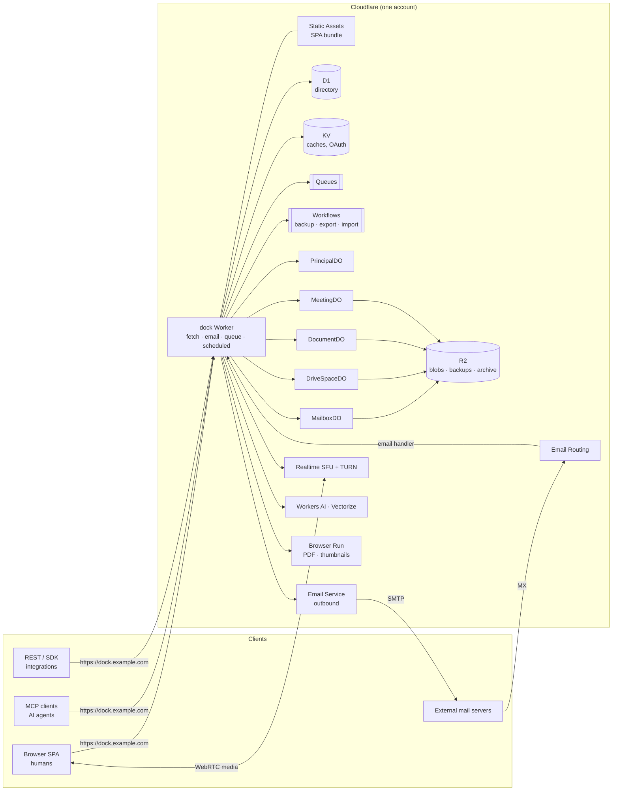
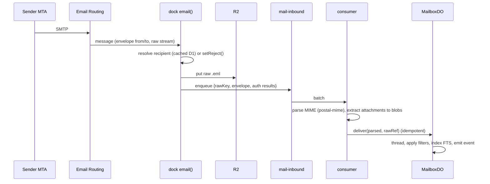

# Architecture

This document describes the target system. It is a living document: when a spike or ADR changes
a decision, update the matching section in the same PR. Statements marked **[spike Sxx.Tyy]** are
working assumptions that the named spike task must confirm or overturn.

## 1. System overview



The backend is one Worker, `apps/dock`, organized as a modular monolith
([ADR-0003](adr/0003-modular-monolith.md)). It serves the SPA, the REST API, the MCP endpoint,
OAuth, WebSockets and file transfer from one hostname. State is split across Durable Objects
keyed by owner ([ADR-0004](adr/0004-data-partitioning.md)). Inbound mail arrives through
Email Routing and is handled by the same Worker's `email()` handler.

## 2. Cloudflare building blocks

| Service | What Soldock uses it for |
| --- | --- |
| Workers (+ Static Assets) | The `dock` Worker: HTTP, WebSocket upgrades, email, queue and cron handlers. Static Assets serve the SPA, falling back to the SPA's index for client routes. |
| Durable Objects (SQLite storage) | One object per principal, mailbox, drive space, document and meeting. Each object holds a transactional SQLite database (≤10 GB per object), alarms and hibernatable WebSockets. |
| D1 | The directory (principals, addresses, groups, domains, credentials, sessions, OAuth clients, agent policies, the object registry). It is small and read-heavy, using read replication through the Sessions API. |
| R2 | Content-addressed blobs (mail MIME, attachments, files, document snapshots, recordings), backups (bucket lock enforces WORM retention), the archive tier and audit log segments. |
| KV | Read-through caches (address routing, public config) and the OAuth provider's grant and token storage if [ADR-0012](adr/0012-auth-architecture.md) chooses it. |
| Queues | Inbound and outbound mail pipelines, outbox delivery, webhooks, indexing, fan-out. Each queue has a DLQ. |
| Workflows | Long-running durable jobs: nightly backups, restore drills, exports (Takeout), imports, retention sweeps, eDiscovery. |
| Email Routing + Email Workers | MX for the mail domains. A catch-all rule delivers every message to the `email()` handler. |
| Email Service (sending) | Outbound mail to the internet through the `send_email` binding (public beta since 2026-04). DKIM, SPF and DMARC are configured at domain onboarding. Lifecycle events (delivered, bounced, complained and so on) arrive on a Queue. Limits per message: 5 MiB and 50 recipients. The daily quota grows with reputation. Cloudflare positions the service for transactional mail, so **[spike S05.T01]** must confirm person-to-person use with Cloudflare ([risks R-01](risks.md)). |
| Realtime SFU + TURN | Meet media. The `dock` Worker mints sessions and TURN credentials, and `MeetingDO` coordinates the room. **[spike S11.T01]** decides between using the SFU directly and RealtimeKit. |
| Workers AI | Speech-to-text for captions and transcripts, optional summaries, embeddings, spam classification. |
| Vectorize | Optional semantic search over mail and Drive content, filtered by ACL metadata (post-S13 enhancement). |
| Browser Run (formerly Browser Rendering) | PDF export of Docs, Sheets and Slides. Slide thumbnails, which also let agents see a slide as an image. |
| Images | Thumbnails and previews of uploaded images. |
| Containers | An optional converter and recorder sidecar for jobs that cannot run in an isolate (for example a LibreOffice-grade conversion or composite meeting recording). It is used only if a spike shows it is needed. |
| Worker secrets (+ Secrets Store when it leaves beta) | Signing keys, backup encryption keys, API tokens. |
| Basin Pipelines (formerly Pipelines) | Optional sink for audit and analytics events, written to R2 as Iceberg tables and queryable with Basin SQL ([S01.T08](stages/S01-identity-access.md)). |
| Analytics Engine + Workers Logs | Metrics for SLOs and dashboards, and structured logs. |
| Access, Turnstile, Rate Limiting | Optional SSO front door, bot protection on public forms, per-principal rate limits. |

## 3. One origin: request routing

Everything is served from `https://<dock-host>` (for example `dock.jaredwray.com`). Static Assets
use SPA fallback, and `run_worker_first` sends the paths below to the Worker:

| Path | Purpose |
| --- | --- |
| `/` and SPA routes (`/mail`, `/drive`, `/d/:id`, `/s/:id`, `/p/:id`, `/meet/:code`, `/admin`, `/settings`) | SPA |
| `/api/v1/*` | REST API generated from the operation registry ([ADR-0006](adr/0006-operation-registry.md)). OpenAPI is at `/api/v1/openapi.json`. |
| `/mcp` | MCP Streamable HTTP endpoint |
| `/oauth/*`, `/.well-known/oauth-authorization-server`, `/.well-known/oauth-protected-resource[/mcp]` | OAuth 2.1 authorization server and protected-resource metadata |
| `/auth/*` | Passkey ceremonies, sign-in and sign-out, first-run setup |
| `/ws/doc/:id`, `/ws/meet/:id`, `/ws/events` | WebSocket upgrades, forwarded to `DocumentDO`, `MeetingDO` and `PrincipalDO` |
| `/blob/*`, `/dl/:token` | Streaming upload (single-shot, or chunked multipart sessions because zone plans cap request bodies at 100–500 MB) and signed, expiring download URLs. R2 presigned URLs only work on `*.r2.cloudflarestorage.com`, so all transfer goes through the Worker to stay on one origin. |
| `/hooks/*` | Inbound callbacks (for example Email Service events and Realtime webhooks) |

**User content on a shared origin.** Google serves user content from a separate domain. Soldock
deliberately does not, so user content is never rendered as active content on the dock origin.
HTML, SVG and other active types are served with `Content-Disposition: attachment` and
`Content-Security-Policy: sandbox`. Previews render in sandboxed iframes without
`allow-same-origin`. Mail HTML is sanitized and rendered in a sandboxed iframe with remote content
proxied ([S04.T06](stages/S04-mail-receive.md)). See [§12](#12-security-model).

Mail domains (for example `@jaredwray.com`) are DNS zones on the same Cloudflare account. Their MX
points to Email Routing. They have no HTTP surface.

## 4. Runtime topology

- **`dock` Worker** (one deployable). Its handlers:
  - `fetch`: Hono router, auth middleware, REST, MCP, OAuth, WebSocket upgrades, blob streaming.
  - `email`: accept or reject, store the raw message to R2, enqueue `mail-inbound`.
  - `queue`: consumers for every queue, dispatched by queue name to domain job handlers.
  - `scheduled`: a cron table (backup kick-off, retention sweeps, restore drills, metrics rollups).
  - It also re-exports every Durable Object and Workflow class.
- **Durable Object classes** (all SQLite-backed, all extending `SoldockObject`, described in [§7](#7-cross-cutting-patterns)):

| Class | Keyed by | Holds | Expected size |
| --- | --- | --- | --- |
| `PrincipalDO` | principal id | Settings, event feed, notifications, idempotency keys, webhook subscriptions, per-user Drive state (recent, starred, shared-with-me index) | Small (MBs) |
| `MailboxDO` | mailbox id | Messages (metadata and text), threads, labels, filters, drafts, FTS index, outbox | ≈5 KB per message, about 2M messages before limits |
| `DriveSpaceDO` | space id (My Drive or a shared drive) | Item tree, versions, permissions, trash, FTS index, change feed | ≈1–2 KB per item |
| `DocumentDO` | item id of a native doc, sheet or deck | CRDT update log, snapshots, comments, suggestions, version index, presence | Typically under 50 MB |
| `MeetingDO` | meeting id | Roster, lobby, chat, track registry, recording and transcript state | Small and short-lived |

- **Workflows**: `BackupRun`, `RestoreDrill`, `RestoreObject`, `ExportArchive`, `ImportMailbox`,
  `ImportDrive`, `RetentionSweep`, `DiscoverySearch`.
- **Queues**: `mail-inbound`, `mail-outbound`, `outbox`, `webhooks`, `index`, `jobs`. Each has a
  `-dlq`.
- **Optional satellites** (separate Workers or Containers, still on the same origin through a
  service binding): a document converter or a meeting recorder, added only if the spikes in
  S08, S09, S10 and S11 show isolates cannot do the job within Worker limits.

## 5. Identity and access

Defined in [ADR-0005](adr/0005-unified-principals.md). Built in S01–S02.

**Principals.** A principal is any identity that can act or own data: `human`, `agent`, `group`,
or `system` (internal jobs). Humans and agents both have a primary address, a mailbox, a My Drive
space, a `PrincipalDO`, credentials and audit history. Agents also have:

- a **sponsor**: an accountable human who can see the agent's activity, pause it and approve its policy changes
- an **agent policy**: a scope ceiling, outbound mail mode (`internal-only`, `allowlist` or `any`),
  external sends that need approval, rate and volume limits, storage quota, and allowed MCP toolsets
- a visible **agent badge** wherever the agent appears (message headers, presence cursors, sharing dialogs, audit)

**Credentials and tokens**

| Credential | Who | Used for |
| --- | --- | --- |
| Passkey (WebAuthn) and recovery codes | humans | Browser sign-in, creating a session cookie (`__Host-` prefixed, HttpOnly, SameSite=Lax) |
| Cloudflare Access JWT (optional) | humans | SSO mode. Access sits in front of `/auth/sso`, and Soldock maps the identity just in time. |
| Agent API key (`sdk_…`, hashed at rest, scoped, expiring) | agents (and humans as personal access tokens) | `Authorization: Bearer` on `/mcp` and `/api` |
| OAuth client bound to an agent (`client_credentials`, secret or `private_key_jwt`) | agents | Standards-based machine-to-machine MCP auth. The token subject is the agent itself. |
| OAuth authorization code + PKCE (DCR or Client ID Metadata Document) | MCP clients acting **for a human** | Delegated access. The token subject is the human, the actor is the client, and the human approves the scopes on a consent screen. |

**Authorization.** Every operation declares required scopes. A request carries an `AuthContext`
`{ principalId, kind, orgRole, groupIds, scopes, actor?, delegatedBy?, agentPolicy? }`. Access is
the intersection of three checks:

1. **token scopes** ⊇ the operation's scopes
2. **resource permission**: the owning object's ACL. Mailbox delegation and Drive roles
   (`owner`, `editor`, `commenter`, `viewer`) inherit down the folder tree and are evaluated by the
   owning Durable Object, which is authoritative.
3. **agent policy** for agent principals, which can only narrow (for example blocking an external send
   or routing it to sponsor approval)

Org roles are `owner`, `admin`, `auditor` (audit, eDiscovery, read-only) and `member`.
Delegation (a human granting an agent access to their mailbox or a folder) is a normal grant on
the resource. It never shares credentials.

**Audit.** Every mutating operation and every privileged read (admin, eDiscovery, delegation use)
emits an audit event `{ actor, actorKind, onBehalfOf, client, op, target, result, ip, ts }`. Events
go through a queue to R2 as hash-chained, gzip NDJSON segments partitioned by day, in a bucket
with a retention lock. A rolling 90-day index sits in D1 for the admin UI.

## 6. Data placement

| Data | Store | Partition |
| --- | --- | --- |
| Org settings, domains, principals, addresses and aliases, group membership, passkeys, sessions, API keys, OAuth clients, agent policies, object registry | D1 `directory` | Global (small: about 50 MB for 10k principals) |
| Mail metadata, threads, labels, filters, FTS | `MailboxDO` | Per mailbox |
| Raw MIME (`.eml`) and attachments | R2 `blobs` (content-addressed `sha256/<hash>`) | Global, immutable |
| Drive tree, ACLs, versions, FTS | `DriveSpaceDO` | Per space |
| File content and versions | R2 `blobs` | Global, immutable, deduplicated |
| Native doc, sheet and deck content | `DocumentDO` (update log and latest snapshot), R2 (version snapshots) | Per document |
| Meeting state | `MeetingDO` | Per meeting |
| Recordings and transcripts | R2 `blobs`, filed into the host's Drive as items | |
| Event feeds, notifications, user settings | `PrincipalDO` | Per principal |
| Audit log | R2 `audit` (locked), with a D1 recent index | Daily segments |
| Backups | R2 `backups` (bucket lock), optionally a second account or jurisdiction | Per run |
| Long-term archive and exports | R2 `archive` (Infrequent Access class) | Per export |
| Metrics | Analytics Engine | |

**Content addressing.** Blobs are stored under the SHA-256 of their bytes and are never mutated.
References are counted in the owning objects. A mark-and-sweep GC with a grace period, which
honours backup retention and legal hold, deletes unreferenced blobs ([S03.T08](stages/S03-platform-services.md)).

**Data residency.** Durable Object namespaces and R2 buckets can be created in a jurisdiction
(for example `eu`). The deployment config exposes this choice once, at provisioning time.

## 7. Cross-cutting patterns

- **Operation registry** ([ADR-0006](adr/0006-operation-registry.md)). Every capability is an
  operation in `packages/contracts`: a name, a summary, Zod input and output schemas, required scopes,
  annotations (`readOnly`, `destructive`, `idempotent`, `openWorld`), its errors and the events it
  emits. The backend binds a handler to each operation. Adapters generate the REST route, the
  OpenAPI document, the MCP tool and the typed client used by the SPA and SDK. **No feature ships
  only in the UI.**
- **`SoldockObject` base class** (S00.T08). It is the common base for all Durable Objects and
  provides versioned SQLite migrations that run in `blockConcurrencyWhile` on first access, a
  `changes` table (a monotonic `seq` per object, used by backups, indexing and sync), a
  **transactional outbox** (side effects are written in the same transaction as the state change
  and delivered by an alarm with retries), idempotency-key storage, object-registry self-registration,
  and the backup contract (`exportSnapshot`, `exportChanges(sinceSeq)`, `importSnapshot`).
- **Idempotency.** Every mutating operation accepts an idempotency key (the `Idempotency-Key`
  header, or `idempotency_key` in MCP). Queue consumers are idempotent by message key, because
  queue delivery is at least once.
- **Events.** Domain events (`mail.message.received`, `drive.item.shared`,
  `doc.comment.mentioned`, `meet.recording.ready`) are defined in contracts. They are delivered to
  `PrincipalDO` feeds (for the UI badge and live updates, MCP `events_poll` and `events_wait`) and to
  webhook subscriptions.
- **IDs.** Prefixed, time-sortable IDs: `<prefix>_<26-char Crockford base32 of UUIDv7>`. Prefixes
  include `prn` (principal), `mbx`, `msg`, `thr`, `lbl`, `spc`, `itm`, `ver`, `cmt`, `mtg`, `key`,
  `cli`, `ses`, `evt`, `job` and `bak`.
- **Errors.** A typed error catalogue in contracts (for example `not_found`, `forbidden`,
  `conflict`, `quota_exceeded`, `rate_limited`, `policy_denied`, `approval_required`, `invalid`).
  It maps to HTTP status plus a JSON problem body, and to MCP tool errors with the same code.
- **Time and randomness** are injected (a `Clock` and an `Ids` service), so tests are deterministic.
- **Migrations.** D1 uses wrangler migrations, applied on deploy. Each Durable Object class carries
  its own ordered migration list, applied lazily when the object wakes. Migrations only move
  forward and every one is tested against a fixture of the previous schema.

## 8. Product subsystems

### 8.1 Mail (S04–S05)



- **Addresses.** `addresses` (D1) maps local parts and aliases to a mailbox or group. Groups expand to
  their members' mailboxes, or to a shared mailbox (a collaborative inbox). Plus-addressing is
  supported. Unknown recipients are rejected during the SMTP transaction.
- **Mailbox model.** Messages carry Gmail-style labels (system labels `INBOX`, `SENT`, `DRAFT`,
  `TRASH`, `SPAM`, `STARRED`, `IMPORTANT`, `UNREAD`, plus user labels). Archiving removes `INBOX`.
  Threads come from `References` and `In-Reply-To`, falling back to the normalized subject within a
  time window.
- **Search.** SQLite FTS5 inside `MailboxDO`. Durable Object SQLite supports FTS5, and
  S03.T09 builds the shared search framework. It supports Gmail operators (`from:`,
  `to:`, `subject:`, `label:`, `is:`, `has:attachment`, `filename:`, `before:` and `after:`,
  `older_than:` and `newer_than:`, `-`, `OR`, quoted phrases).
- **Outbound.** `mail_send` writes to the mailbox outbox (with an optional undo-send delay through an
  alarm), then to the `mail-outbound` queue. Local recipients are delivered directly to their
  mailboxes and never touch Email Service. External recipients go through Email Service, adapted to
  its limits:
  - Attachments that would push a message past 5 MiB become Drive links, which is what Gmail does
    above 25 MB.
  - More than 50 recipients are split into batches that share one `Message-ID`.
  - Lifecycle events from Email Service's Queue (delivered, deferred, bounced, complained,
    suppressed) update the delivery status on the sending mailbox.

  Agent policy is enforced before the message enters the outbox. Auto-forwarding to external
  addresses re-sends through Email Service, because Email Routing's `forward()` only accepts
  verified destinations.
- **Safety.** Inbound HTML is sanitized (allowlist) and rendered in a sandboxed iframe. Remote
  images are blocked by default and proxied when allowed, to defeat tracking pixels.
  Authentication results (SPF, DKIM, DMARC, ARC) are recorded, and DMARC failures are quarantined.
  Content sent by external senders is marked `untrusted` in API and MCP responses.

### 8.2 Drive (S06)

- One `DriveSpaceDO` per space: each principal's **My Drive**, plus **shared drives** owned by groups.
  Every item lives in exactly one space and has one parent.
- Item kinds: `folder`, `file`, `doc`, `sheet`, `slides`, `shortcut`. A native item (`doc`,
  `sheet`, `slides`) has a companion `DocumentDO` keyed by the item id.
- **Permissions** are stored on items and inherited down the tree. Grantees can be a principal, a
  group, the whole org (`org`) or a link (`anyone-with-link`, which an admin can disable). The space
  object is authoritative. A share writes an outbox entry that updates the grantee's
  `PrincipalDO` "shared with me" index and sends a notification.
- **Opening native documents.** The client asks the space object to open an item. The space object checks
  the ACL and issues a short-lived signed **document ticket** `{itemId, principalId, role, exp}`.
  `DocumentDO` accepts WebSocket connections only with a valid ticket. When access is revoked, the space
  object tells the `DocumentDO` to drop that principal's sockets.
- **Uploads** stream through the Worker into R2 (single-shot, or multipart sessions for large
  files). Downloads stream back from R2 with range support. This keeps everything on one origin
  ([§3](#3-one-origin-request-routing)).

### 8.3 Collaboration engine (S07)

- A CRDT with **Yjs** as the default **[spike S07.T01]** ([ADR-0010](adr/0010-yjs-collaboration.md)).
  `DocumentDO` runs the y-protocols sync and awareness over hibernatable WebSockets, persists each
  update to SQLite, compacts updates into snapshots, and writes version checkpoints to R2.
- **Server-side editing.** MCP and REST edits run as a headless Yjs client inside `DocumentDO`. Each
  edit is a transaction whose origin is the acting principal, so humans see an agent's edits live,
  along with the agent's presence.
- Comments, suggestions (tracked changes), mentions, assignments and version history are shared
  across Docs, Sheets and Slides.

### 8.4 Docs, Sheets and Slides (S08–S10)

| | Docs | Sheets | Slides |
| --- | --- | --- | --- |
| Editor | TipTap 3 (MIT core) on ProseMirror with y-prosemirror | Canvas-virtualized grid over a workbook CRDT | Canvas or SVG stage, with TipTap for text boxes |
| CRDT model | `Y.XmlFragment` | Row and column ID arrays, a cell map keyed by `rowId:colId`, formulas stored with ID-based references | Deck → slide array → element maps, rich text per element |
| Calculation | — | Formula engine on the client and on the server **[spike S09.T01]** (IronCalc WASM is the leading candidate) | — |
| Agent format | Markdown (GFM) and ProseMirror JSON, plus anchored edit operations | A1 ranges (values, formulas, formatted values), CSV, batch updates | Outline JSON or Markdown, element operations, slide thumbnails as images |
| Import and export | DOCX, Markdown, HTML, PDF, TXT | XLSX, CSV, PDF | PPTX, PDF, PNG |

Pure model code (schemas, converters, address math) lives in `packages/*-model`, so the SPA and
the Worker share one implementation.

### 8.5 Meet (S11)

- `MeetingDO` owns the meeting: meeting code, lobby and admission, roles (host, co-host,
  participant, guest, agent), chat, hand raises, host controls, and the registry of published tracks.
  It coordinates clients over a hibernatable WebSocket.
- Media flows from browsers to the Cloudflare Realtime SFU. The Worker holds the Realtime app
  secret and creates sessions, pushes and pulls tracks for clients, and mints TURN credentials.
- **Captions, transcription and agent participants** use the SFU **WebSocket media adapter** (GA
  since 2026-09). It streams PCM audio from the SFU to a Durable Object, which feeds Workers AI
  speech-to-text (`@cf/deepgram/nova-3` over WebSocket). It also takes PCM back in, so an agent can
  speak through TTS, and it offers video egress as 1 fps JPEG, so an agent can glance at a shared
  screen.
- **Recording** has three candidates, chosen in **[spike S11.T01]**:
  - a Containers-based recorder that pulls tracks from the SFU
  - RealtimeKit recording into our R2 bucket. Its UI kit is Apache-2.0 but its core SDK ships only
    compiled code, which conflicts with P6 if it becomes a hard dependency.
  - client-side composite recording by the host
- Scheduling sends ICS `REQUEST` and `CANCEL` invites through Mail and parses `REPLY` messages. There
  is no calendar product.

## 9. Scale model

**v1 design targets** (validated by load tests in S13):

| Dimension | Target |
| --- | --- |
| Principals (humans + agents) | 5,000 in one deployment, designed to reach 50,000 |
| Concurrently active users | 1,000 |
| Mail | 250k inbound and 50k outbound messages per day, inbound bursts of 50 messages per second |
| Storage | 50 TB in R2, 10M Drive items |
| Collaboration | 1,000 open documents, 50 concurrent editors in one document |
| Meet | 50 concurrent meetings, up to 100 participants each **[spike S11.T01]** |
| Agents | 500 active agents, 100 MCP calls per second in aggregate |

**SLOs** (p95, client on the same continent): REST and MCP reads under 300 ms and writes under
500 ms. Inbound mail visible in the UI within 10 s. Document sync fan-out under 250 ms. Backup
completion under 6 h every night. Restore of a single mailbox or drive under 1 h.

**Why it scales.** Load is partitioned by owner, so adding users adds objects, not load on
shared ones. The only shared stores are D1 (small, read-mostly, replicated, cached) and Queues
(5k messages per second each, sharded by name if needed). Per-object load stays modest. The
heaviest is a busy shared mailbox or a 50-editor document, which is well within one Durable
Object's throughput. Large data lives in R2. Hot fan-outs (group mail, sharing with large groups)
go through queues in batches, not synchronous loops.

**Limits to watch** (tracked in [risks.md](risks.md)):
- 10 GB of storage and a soft limit of about 1,000 requests per second per Durable Object
- 128 MB of isolate memory, which matters for large CRDT documents and spreadsheets
- 64 MiB uncompressed Worker bundle size, which matters for editor models and a WASM formula engine on the server
- Email Service limits (5 MiB per message, 50 recipients, a daily quota that grows with reputation)
- Realtime SFU participant limits
- The Rate Limiting binding is per location and eventually consistent. Hard caps, such as an agent's
  daily send quota, are therefore counted in `PrincipalDO`, not in the Rate Limiting binding.

## 10. Backup, archive and recovery

Defined in [ADR-0007](adr/0007-backup-and-archive.md). The framework is built in S03, and every
later stage plugs its stores into it. The user-facing archive and retention features come in S12.

| Tier | Protects against | Mechanism | Window |
| --- | --- | --- | --- |
| T0: platform durability | Hardware loss | R2 and Durable Object durability, which are replicated by Cloudflare | — |
| T1: point-in-time | Bad deploys, bugs | D1 Time Travel. Durable Object SQLite PITR (`getBookmarkForTime` / `onNextSessionRestoreBookmark`). | 30 days |
| T2: logical backups | Logical corruption, deletion, account compromise | Nightly `BackupRun` workflow: an incremental (`changes` since the last seq) or weekly full export of every registered object and of D1, as versioned NDJSON. D1 is dumped with batched `SELECT`s, because the export API blocks the database and cannot export virtual tables. Every file has a manifest and a checksum, is optionally encrypted, and is written to the `backups` bucket under a retention lock. Blobs that a backup references are protected from GC. | Configurable, 35 days locked by default, plus monthly fulls kept for a year |
| T3: disaster recovery copy | Loss of the account or region, or a compromised admin | Replication of `backups` and `blobs` to a locked bucket in a **separate Cloudflare account**. The primary writes to it with an object-scoped token that cannot change the lock **[S03.T08 verifies]**. Anyone with bucket access can remove an R2 bucket lock, so a separate account is the only real isolation. | Same as T2 |
| T4: archive and retention | Compliance, departures, legal | Retention policies, legal holds, eDiscovery, org archive exports (S12) | Policy-defined |
| T5: user exports | Data portability | Takeout-style export: mbox and EML, original files plus Office and PDF conversions, Markdown and CSV, recordings, JSON metadata | On demand |

A weekly `RestoreDrill` workflow restores a random sample of objects into scratch objects and
verifies checksums and invariants. A failed drill alerts the admins. A full disaster-recovery
rebuild into a new account is scripted and rehearsed (S12.T08).

## 11. MCP and the agent surface

Built in S02, and every product stage adds its tools.

- **Endpoint:** `https://<dock-host>/mcp` (Streamable HTTP). It targets the current MCP
  specification (2026-07-28: stateless, with `server/discover` and the `MCP-Protocol-Version` header)
  and stays compatible with 2025-11-25 clients. It is built on the stateless `createMcpHandler`
  from the `agents` SDK, because `McpAgent` is deprecated **[spike S02.T01]**.
- **Discovery and authentication:** a `401` with `WWW-Authenticate` pointing to
  `/.well-known/oauth-protected-resource/mcp` (RFC 9728). Token audience is validated against the
  resource (RFC 8707). Client registration follows the spec's order: pre-registered clients, then
  Client ID Metadata Documents, then DCR, which the spec now deprecates but is kept for older
  clients. Accepted credentials, in order of preference for an **agent's own identity**:
  1. **Agent API keys** as static bearer tokens. This works with every client that supports custom headers.
  2. **`client_credentials`** tokens for OAuth clients bound to an agent. The MCP extension is still a
     draft and `workers-oauth-provider` does not implement this grant, so Soldock adds it (S02.T04).

  **Delegated human access** uses authorization code + PKCE.
- **Tools** are generated from the operation registry: `mail_search`, `mail_get_thread`,
  `mail_send`, `drive_list`, `drive_upload`, `docs_read`, `docs_edit`, `sheets_read_range`,
  `sheets_write_range`, `slides_create_from_outline`, `meet_create`, `meet_get_transcript`,
  `events_wait`, and so on. Tools are filtered by the caller's scopes and agent policy, and can be
  narrowed further with `?toolsets=mail,drive`. Annotations map from the operation annotations.
  Results carry `structuredContent` and a readable text rendering.
- **Resources** expose items, messages, attachments and transcripts by URI
  (`soldock://drive/items/{id}` and similar). Large binaries are returned as resource links or signed
  `/dl/` URLs.
- **Agent ergonomics:** agent-friendly formats (Markdown, A1 ranges, outlines), cursor
  pagination, `dry_run` on bulk and destructive operations, idempotency keys, long-poll
  `events_wait` with a filter so an agent can wait for mail, and asynchronous jobs with a `jobs_get` tool.
- **Agent safety:** external content is wrapped in an `untrusted` envelope with its provenance.
  Outbound actions are bounded by agent policy (rate limits, recipient allowlists, sponsor
  approval queues). A sponsor or admin kill switch suspends an agent and revokes its tokens at once.
  Every call is audited with the actor kind.

## 12. Security model

- **Threat model** in `docs/security/threat-model.md`. It starts in S01 and is updated by every stage
  as part of its exit gate.
- **Browser:** strict CSP, `frame-ancestors 'none'`, `__Host-` cookies, an Origin check on every
  mutating request, Trusted Types where supported. Content an attacker could control is never
  rendered as active content on the dock origin (see [§3](#3-one-origin-request-routing)).
- **Mail-specific:** sanitizer allowlist, header-injection-safe composition, open-redirect-safe
  link rewriting, attachment type warnings, SPF, DKIM and DMARC handling, rate limits on outbound mail.
- **Server:** SSRF guard for webhooks and imports (no private ranges, no Cloudflare-internal hosts),
  size and time limits on every parser, input validation by Zod at every boundary, and an
  authorization matrix test (every operation × role × principal kind) in CI from S02 on.
- **Secrets:** Worker secrets and Secrets Store, never in code or D1. Keys are rotatable. Backup
  encryption keys are held separately from the backup bucket's credentials.
- **Agents and prompt injection:** untrusted-content envelopes, policy-bounded outbound actions,
  an approval workflow, and a red-team suite in S13.
- **Accessibility and privacy:** WCAG 2.2 AA, no third-party trackers, and analytics stays inside Cloudflare.

## 13. Observability

- Structured JSON logs with `requestId`, `principalId`, `op`, `objectId` and `durationMs` go to
  Workers Logs. Trace IDs propagate to Durable Objects, queues and workflows.
- Analytics Engine datasets: `ops` (per-operation latency and outcome), `mail` (volume,
  deliverability), `collab` (connections, update rates), `meet` (sessions, quality), `jobs`
  (backlog, failures), `backup` (run duration, bytes, drill results).
- An admin health page shows SLOs, queue depth, DLQ size and backup status. Scheduled checks send
  alerts to admins by email and to their event feeds.

## 14. Frontend architecture

- React 19 + Vite with TanStack Router and TanStack Query. Tailwind CSS with Radix-based components
  in `packages/ui`. It is one SPA with feature modules (`mail`, `drive`, `docs`, `sheets`, `slides`,
  `meet`, `admin`, `settings`) that mirror the backend domains ([ADR-0009](adr/0009-toolchain.md)).
- A typed client generated from `packages/contracts` gives the UI the same operations the API and MCP
  expose. A single `/ws/events` connection drives badges and live list updates, and editors open
  per-document sockets.
- Responsive and installable as a PWA. Editors cache documents in IndexedDB for reconnection.
- Performance budgets (initial JS, route chunks, Web Vitals) are enforced in CI from S13 on and tracked from S00.

## 15. Repository layout

```text
soldock/
├── apps/
│   ├── dock/                   # the Worker: the entire backend, one deployable
│   │   ├── wrangler.jsonc
│   │   ├── migrations/         # D1 (directory) migrations
│   │   ├── src/
│   │   │   ├── index.ts        # fetch / email / queue / scheduled; re-exports DO + Workflow classes
│   │   │   ├── platform/       # http, errors, ids, config, logging, metrics, blobs, jobs, outbox, events, backup, search
│   │   │   ├── identity/       # principals, directory, passkeys, sessions, API keys, OAuth AS, authz, audit
│   │   │   ├── api/            # REST adapter + OpenAPI generation over the operation registry
│   │   │   ├── mcp/            # MCP adapter over the operation registry
│   │   │   ├── mail/           # MailboxDO, inbound/outbound pipelines, MIME, threading, search
│   │   │   ├── drive/          # DriveSpaceDO, uploads, sharing, previews
│   │   │   ├── collab/         # DocumentDO, sync, presence, comments, versions
│   │   │   ├── docs/           # server-side Docs operations (read/edit/convert)
│   │   │   ├── sheets/         # server-side Sheets operations and recalculation
│   │   │   ├── slides/         # server-side Slides operations and rendering
│   │   │   ├── meet/           # MeetingDO, Realtime SFU/TURN client, recording, transcripts
│   │   │   └── archive/        # exports, retention, legal hold, eDiscovery, imports, restore operations
│   │   └── test/               # workerd integration tests (vitest-pool-workers)
│   └── web/                    # the SPA (React + Vite), built into dock's static assets
├── packages/
│   ├── contracts/              # operation registry: schemas, scopes, errors, events (shared by dock, web, sdk)
│   ├── docs-model/             # ProseMirror schema + Yjs helpers + Markdown/DOCX/HTML converters
│   ├── sheets-model/           # workbook CRDT model, A1 math, formula adapter, XLSX/CSV
│   ├── slides-model/           # deck CRDT model, layouts/themes, PPTX/outline converters
│   ├── ui/                     # design system
│   └── sdk/                    # public TypeScript client
├── tools/
│   ├── plan/                   # `pnpm plan`: next / show / check / status
│   ├── licenses/               # dependency license policy check
│   └── cli/                    # `soldock` operator CLI: provision, backup, restore, import
├── e2e/                        # Playwright end-to-end tests
├── docs/                       # user, admin, self-hosting, agent and security docs
├── plan/                       # this plan: vision, architecture, process, ADRs, stages, status
└── .claude/                    # skills and reviewer agents that implement the process
```

**Module rules.**

1. Each `apps/dock/src/<domain>/` has an `index.ts` that is its only public surface, and a
   `README.md` stating what it owns, what it depends on, its data stores, its backup coverage and its operations.
2. A domain imports another domain only through that domain's `index.ts`. `platform/` imports no
   domain. The `api/` and `mcp/` adapters import only `platform/` and `identity/`. The composition
   root (`src/index.ts`) wires each domain's operation implementations into the registry the
   adapters serve. `packages/*` never import from `apps/*`. These rules are checked in CI (S00.T07).
3. Durable Object classes live in `<domain>/*.do.ts`, queue consumers in `<domain>/jobs.ts`, and
   SQLite migrations in `<domain>/schema/`.

## 16. Environments, deployment and configuration

- **Local:** `pnpm dev` runs the Vite dev server with the Cloudflare Vite plugin. The Worker, its
  Durable Objects, D1, R2, KV and Queues all run locally in workerd/Miniflare. A local inbound-mail
  simulator posts `.eml` fixtures to the `email()` handler.
- **Staging:** `dock-staging.<domain>` with its own resources and a staging mail subdomain. Deployed on every
  merge to `main`.
- **Production:** deployed from release tags (S14). Before Soldock reaches production, the plan's
  stage gates control readiness.
- **Provisioning:** `soldock provision` creates the D1 database, R2 buckets (with lifecycle rules and bucket
  locks), KV namespaces, queues and their DLQs, Email Routing rules and the DNS records for the mail domains.
  It is idempotent and prints the `wrangler.jsonc` bindings. A "Deploy to Cloudflare" button arrives in S14.
- **Configuration** comes from three places: `wrangler.jsonc` vars (hostnames, mail domains, jurisdiction), secrets
  (keys) and D1 `settings` (runtime-adjustable policies, edited in the admin console).
